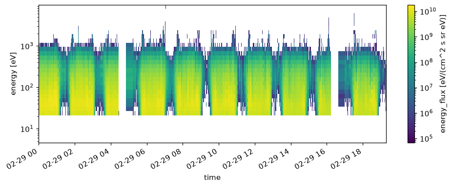

# First Plot

This page walks through the electron energy flux measured by KAGUYA PACE ESA1 on 2008-02-29, from retrieval to plotting.
It assumes network access and a Python environment with at least `[kaguya,viz]` from [Installation](install.md).

## 1. Choose where data is stored

SOPRAN keeps retrieved source files and the intermediate data it creates in one directory called the **Store**.
First set the default Store for the session.

```python
import sopran as spn

spn.config.use(store="/path/to/sopran_data")
```

This setting lasts for the current Python process. [Configuration](../guide/configuration.md) shows how to make it permanent.

## 2. Create a time range

```python
time = spn.day("2008-02-29")
```

`spn.day` returns 2008-02-29 00:00 up to, but not including, the next day 00:00 (a half-open interval).
`spn.period(start, stop)`, `spn.month("2008-02")`, and `spn.year("2008")` create ranges as well.

## 3. Plot

```python
result = spn.kaguya.esa1.energy_flux.plot(time)
result.fig
```

SOPRAN then does the following in order:

1. If that day's PACE ESA1 source file is not in the Store, download it from the JAXA DARTS public archive into `raw/`.
2. Decode the file into a `time × energy × look` count array.
3. Fetch the PACE calibration table (INFO) and convert counts to energy flux.
4. Draw a spectrogram with time on x, energy on y, and flux as color.



The y axis and the colorbar are logarithmic by default, and the colorbar shows the variable name and units,
such as `energy_flux [eV/(cm^2 s sr eV)]`. Set the visible range with `ylim=(10, 10000)`, `vmin=1e6`, and `vmax=1e9`.
From the second run on, the source file and calibration table are read from the Store without network access.

## 4. Load as an array

For analysis, `load()` returns the array.

```python
flux = spn.kaguya.esa1.energy_flux.load(time)
flux.info()          # dimensions, units, and source files
flux.to_xarray()     # xarray.DataArray
flux.files           # source files that were read
```

The returned `SopranArray` is an xarray array with units, frame, provenance, and processing history attached.
`flux.plot()` draws the same figure, and results of `sel` or `mean` keep the same type.

## 5. Save the figure

```python
flux.quicklook("esa1_energy_flux_20080229", root="reports")
```

This writes a PNG to `reports/` together with a JSON record of the time range, panel types, and axis and colorbar labels (with units).
Pass `formats=("png", "html")` to also write an HTML page that combines the image and the record.

## Next

- To see which other variables exist and what you can check before loading, read [Exploring Data](explore.md).
- To repeat analyses with a fixed period and region, read [Reproducible Analysis](reproducible.md).
- PACE calibration and caveats are described in [PACE](../data/kaguya/pace.md).
